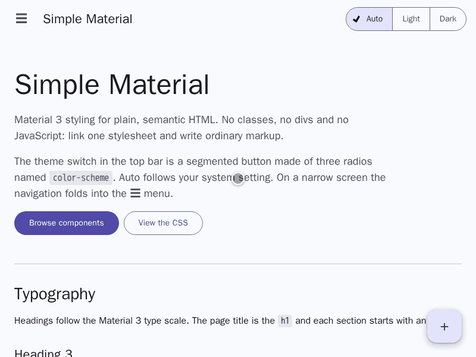

# Simple Material

Classless Material Design styles for semantic HTML, in a single CSS file.

See every component on the [showcase page](https://andrerenaud.github.io/simple_material/showcase.html).



## Goals

- Pure HTML and CSS, framework agnostic, no JavaScript
- Semantic elements instead of classes wherever possible
- Accessible, with keyboard focus and screen readers in mind
- Discreet animations, driven purely by CSS
- Small files, targeting the latest browsers and their newest features

## Usage

```html
<link rel="stylesheet" href="simple_material.css" />

<button>Filled</button>
<button data-variant="outlined">Outlined</button>

<article>
  <h3>Title</h3>
  <p>Supporting text.</p>
  <footer><button>Action</button></footer>
</article>
```

Elements are styled as they are. Where Material has several styles for one
element, pick one with `data-variant`, and arrange children with
`data-layout`.

## Colour themes

Every colour role is derived from a hue, so each theme works in light and dark
mode. Violet is the default; pick another with `data-theme` on the `html`
element:

```html
<html lang="en" data-theme="teal">
  <head>
    <link rel="stylesheet" href="simple_material.css" />
  </head>
</html>
```

| Theme    | Primary and accent          | Based on                                                                  |
| -------- | --------------------------- | ------------------------------------------------------------------------- |
| `rose`   | rose, blue-violet           | [ff006e …](https://coolors.co/palette/ffbe0b-fb5607-ff006e-8338ec-3a86ff) |
| `orange` | orange, deep blue           | [f77f00 …](https://coolors.co/palette/003049-d62828-f77f00-fcbf49-eae2b7) |
| `olive`  | moss green, copper; warm    | [606c38 …](https://coolors.co/palette/606c38-283618-fefae0-dda15e-bc6c25) |
| `teal`   | Persian green, burnt sienna | [2a9d8f …](https://coolors.co/palette/264653-2a9d8f-e9c46a-f4a261-e76f51) |
| `navy`   | blue, gold; navy surfaces   | [003566 …](https://coolors.co/palette/000814-001d3d-003566-ffc300-ffd60a) |

To make your own, set the same four values on `:root`:

```css
:root {
  --hue: 150; /* primary hue, in degrees */
  --tertiary-hue: 30; /* accent hue, used by mark */
  --chroma: 0.8; /* how colourful the accents are */
  --tint: 1.5; /* how strongly the hue tints surfaces */
}
```

A `select` named `theme` whose option values are the theme names switches
between them without JavaScript, as the one in the showcase's navigation does.

## Development

- `make format` formats the HTML, CSS and scripts with Prettier.
- `make shoot` screenshots the showcase in headless Chromium, Firefox and
  WebKit using Podman. Output goes to `screenshots/`.
- `make gif` records an 800×600 tour of the showcase to `docs/showcase.gif`.
