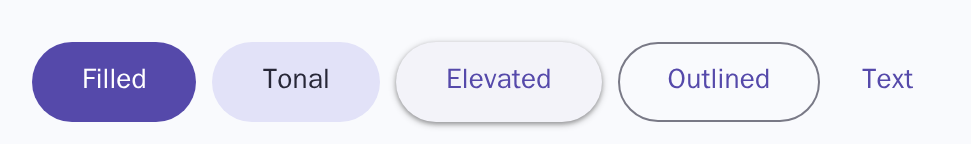
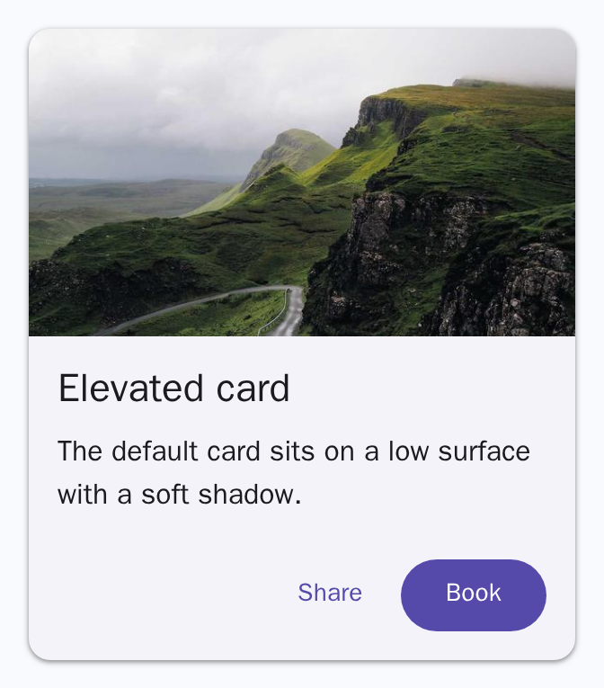

# Simple Material

Classless Material Design styles for semantic HTML, in a single CSS file.

See every component on the [showcase page](https://andrerenaud.github.io/simple_material/showcase.html).





## Goals

- Pure HTML and CSS, framework agnostic, no JavaScript
- Semantic elements instead of classes wherever possible
- Accessible, with keyboard focus and screen readers in mind
- Discreet animations, driven purely by CSS
- Small files, targeting the latest browsers and their newest features

## Usage

```html
<link rel="stylesheet" href="simple_material.css" />

<button>Filled</button>
<button data-variant="outlined">Outlined</button>

<article>
  <h3>Title</h3>
  <p>Supporting text.</p>
  <footer><button>Action</button></footer>
</article>
```

Elements are styled as they are. Where Material has several styles for one
element, pick one with `data-variant`, and arrange children with
`data-layout`. Set `--hue` on `:root` to change the theme colour.

## Development

- `make format` formats the HTML, CSS and scripts with Prettier.
- `make shoot` screenshots the showcase in headless Chromium, Firefox and
  WebKit using Podman. Output goes to `screenshots/`.
